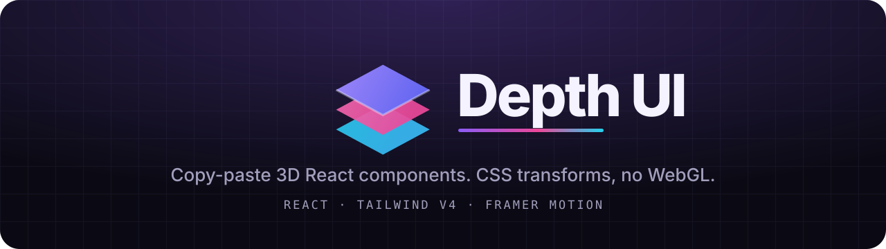
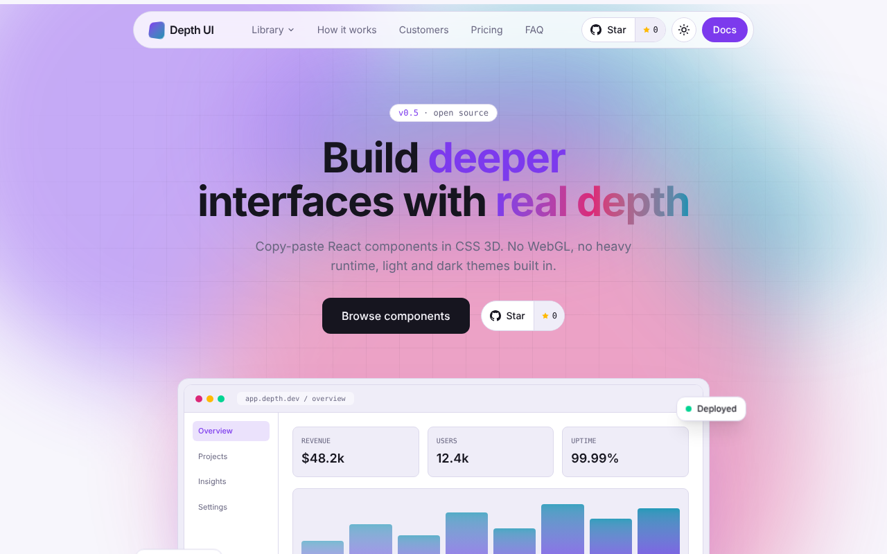

<div align="center">

<picture>
  <source media="(prefers-color-scheme: dark)" srcset=".github/assets/banner-dark.svg">
  
</picture>

<br />

[](https://github.com/depthui/depthui/actions/workflows/ci.yml)
[](https://github.com/depthui/depthui/actions/workflows/deploy.yml)
[](LICENSE)
[](CONTRIBUTING.md)


[](https://github.com/depthui/depthui/stargazers)

**[Live demo](https://depthui.vercel.app)** · **[Component docs](https://depthui.vercel.app/components)** · **[Report a bug](https://github.com/depthui/depthui/issues/new?template=bug_report.yml)** · **[Request a component](https://github.com/depthui/depthui/issues/new?template=component_request.yml)**

</div>

---

Depth UI is a library of **copy-paste 3D React components** built on **Tailwind CSS v4** and **Framer Motion**.
There is no WebGL and no Three.js. Everything is plain CSS 3D transforms driven by motion values, so it stays
fast, small and themeable. You copy the source into your project (the shadcn way), so you own every line.

<div align="center">
  <picture>
    <source media="(prefers-color-scheme: dark)" srcset=".github/assets/landing-light.png">
    
  </picture>
</div>

## Why Depth UI

- **Real depth, light weight.** CSS `perspective` and `translateZ` on the GPU. Pointer effects use motion values, so React never re-renders while you move the mouse.
- **Copy, don't install.** Each component is a file or two. No runtime dependency on this repo, nothing to upgrade.
- **Light and dark, built in.** One set of CSS variables re-themes everything. A toggle and a no-flash script are included.
- **Accessible.** Keyboard support, ARIA roles, focus management in the modal and drawer, and `prefers-reduced-motion` respected everywhere.
- **80+ pieces.** 3D cards and scenes, 13 button styles, UI elements, and full page blocks (navbar, hero, pricing, footer and more).
- **Docs that cannot go stale.** Every component has Preview, Usage and Source tabs, and the Source tab reads the real files.

## Quick start

```bash
git clone https://github.com/depthui/depthui.git
cd depthui
npm install
npm run dev
```

Open the landing page at `/` and the docs at `/components`. Every component has its own page, for example `/components/globe`.

### Use a component in your own project

1. `npm i framer-motion clsx tailwind-merge`
2. Copy the component file, plus `src/lib/utils.ts`, plus `src/hooks/use-tilt.ts` if it imports it,
   plus `src/styles/depth-motion.css` for components that need CSS keyframes (GridFloor, Marquee3D, Orbit3D, several buttons).
3. Copy the theme tokens, the `@theme inline` block and the 3D utilities from `src/index.css`.
4. Add the theme script from `index.html` and wrap your app in `ThemeProvider`.

```tsx
import { TiltCard, TiltLayer, ShimmerButton } from "@/components/depth";

export function Hero() {
  return (
    <TiltCard className="w-80">
      <TiltLayer z={60}><h3 className="text-2xl font-semibold">Spatial UI</h3></TiltLayer>
      <TiltLayer z={80}><ShimmerButton>Explore</ShimmerButton></TiltLayer>
    </TiltCard>
  );
}
```

## What is inside

<details open>
<summary><b>Cards and 3D scenes</b></summary>

| Component | File | What it does |
| --- | --- | --- |
| `TiltCard` / `TiltLayer` | `tilt-card.tsx` | Pointer tilt, moving glare, per-layer `translateZ` |
| `SpotlightCard` | `spotlight-card.tsx` | Light and glowing border that follow the pointer |
| `HoloCard` | `holo-card.tsx` | Collectible card with rainbow foil and shine |
| `FlipCard` | `flip-card.tsx` | Spring flip on hover / tap / keyboard |
| `CardDeck` | `card-deck.tsx` | Stacked cards, swipe / click / keys to cycle |
| `BookCard` | `book-card.tsx` | Hardcover whose cover swings open |
| `DepthStack` / `DepthLayer` | `depth-stack.tsx` | Layered pointer parallax |
| `Cube3D` | `cube-3d.tsx` | Idle-rotating, draggable cube |
| `Carousel3D` | `carousel-3d.tsx` | Ring carousel with keyboard + click nav |
| `CoverFlow` | `cover-flow.tsx` | Classic album-browser fan layout |
| `Orbit3D` | `orbit-3d.tsx` | Items orbiting a core on tilted rings (CSS only) |
| `LayerStack` | `layer-stack.tsx` | Isometric stack that explodes apart |
| `IsometricGrid` | `isometric-grid.tsx` | Isometric tiles that lift on hover / tap |
| `GridFloor` | `grid-floor.tsx` | Endless perspective grid (CSS only) |
| `Marquee3D` | `marquee-3d.tsx` | Tilted, counter-scrolling marquee columns (CSS only) |
| `ScrollReveal3D` | `scroll-reveal-3d.tsx` | Panel that flattens as it scrolls into view |
| `Button3D` | `button-3d.tsx` | Extruded button that leans and presses |
| `Dock3D` | `dock-3d.tsx` | Magnifying icon dock on a tilted shelf |
| `Text3D` | `text-3d.tsx` | Extruded headline from stacked layers |
| `GitHubStarButton` | `github-star-button.tsx` | "Star on GitHub" pill with a live count; set the repo in `src/lib/site.ts` |
| `ThemeProvider` / `ThemeToggle` / `useTheme` | `theme.tsx` | Light/dark switching |

</details>

<details>
<summary><b>Showpieces</b></summary>

In `src/components/depth/showpieces/`. Each is a single file (plus `lib/utils.ts`; `Coin3D`, `Phone3D` and `Ticket3D` also need `hooks/use-tilt.ts`, `Laptop3D` needs `hooks/use-scroll-progress.ts`).

| Component | Effect |
| --- | --- |
| `Globe3D` | Wireframe globe from CSS circles, markers that hide when they turn away, drag to spin |
| `FlipClock3D` | Split-flap digits that fold over; shows the time or any value |
| `TextCylinder3D` | Words around a vertical cylinder like a slot reel |
| `Coin3D` | Coin with a real rim, tilts with the pointer, flips on click |
| `GalleryWall3D` | Grid on a tilted plane that drifts with the pointer; tiles lift on hover |
| `PageTurn` | Open book whose pages turn like paper (click, buttons or arrow keys) |
| `NotificationStack3D` | Notifications piled in depth that fan out on hover, dismissible |
| `ExpandingPanels3D` | One panel opens wide while neighbours lean away in 3D |
| `TagCloud3D` | Tags on a turning sphere, drag to spin, tags can be links |
| `Laptop3D` | Laptop whose lid opens as you scroll it into view |
| `Folder3D` | Folder that tips open and fans out its papers |
| `Envelope3D` | Envelope with a 3D flap and a letter that rises out |
| `Phone3D` | Phone with real thickness, tilts with the pointer, floating chips |
| `Dice3D` | Six-sided die that tumbles and lands on a random face |
| `Ticket3D` | Boarding pass that tilts under a glare, stub tears off on click |
| `CardFan3D` | Hand of cards in an arc, hovered card rises and neighbours part |
| `PeelCard` | Card with a curling corner that peels back to reveal content |
| `Turntable3D` | Record player with a spinning vinyl and a swinging tonearm |
| `SlotMachine3D` | Three cylinder reels that roll to a random symbol |
| `NewtonsCradle3D` | Desk toy with two-string balls, swing fades out |
| `Bookshelf3D` | Books on a shelf that slide out and turn to show the cover |
| `Prism3D` | Rotating prism used as tabs, 3 to 8 faces |
| `Doors3D` | Double doors on hinges that open on a lit room |
| `RubiksCube3D` | 3x3 puzzle cube of 27 cubies, scramble and solve, drag to look around |
| `Hourglass3D` | Sand runs between bulbs, click to flip even mid-run |
| `Gyroscope3D` | Three nested rings on different axes, pure CSS |
| `Badge3D` | ID badge on a lanyard, drag to swing, settles on a spring |
| `Pyramid3D` | Four-sided pyramid with labelled faces, drag to spin |
| `Helix3D` | Double helix turning in space with real depth cues |
| `Vault3D` | Safe with a working combination dial and a swinging door |
| `FoldPanels3D` | Folding screen of hinged panels that zig-zag shut |
| `EightBall3D` | Magic 8 Ball, shake it and an answer floats up |
| `Compass3D` | Compass whose needle follows your pointer and overshoots |
| `Tunnel3D` | Endless tunnel of glowing frames that bends toward your pointer |
| `PinArt3D` | Pin-impression board, pins rise to meet your pointer |
| `TileFlip3D` | Picture cut into tiles that flip in a ripple from your click |
| `ImageTrail3D` | Cards that follow your pointer and fade away, from a reused pool |
| `DiscoBall3D` | Sphere of mirror tiles that turns and flashes |
| `AnalogClock3D` | Working clock with a raised bezel and hands that cast shadows |
| `PopUpBook3D` | Open book whose paper scenery stands up on hover |
| `SnowGlobe3D` | Glass globe with a village, shake it and the snow settles |
| `Orrery3D` | Tiny solar system on a tilted plane, hover to pause |
| `Gem3D` | Cut gem with see-through facets that flash as it turns |
| `Can3D` | Product can with a label wrapped round a real cylinder |
| `Torus3D` | Doughnut drawn as a hoop of colour-wheel circles, tumbling |
| `GiftBox3D` | Wrapped box whose lid lifts off in a burst of light |
| `Room3D` | A room seen from inside, drag to look around |
| `Tesseract3D` | Cube inside a cube, a hypercube tumbling in 3D |
| `Saturn3D` | Banded planet sitting inside its own ring |
| `Rocket3D` | Cylinder rocket with fins that lights its engine on hover |
| `Pinwheel3D` | Paper pinwheel with folded blades that spins up |
| `Lantern3D` | See-through paper lantern with a flickering light |
| `StackScroll3D` | Cards that pile up on scroll, older ones shrink, tip and dim |
| `DynamicIsland3D` | Pill that morphs between states on one spring, with a 3D tilt |
| `ReorderList3D` | Drag-to-reorder list, the held row lifts and tips toward you |
| `ExpandCards3D` | App Store-style cards that stretch open into a full sheet |
| `Tabs3D` | Tabs with a gliding raised key and panels that swing on a hinge |
| `Accordion3D` | Accordion whose panels unfold downward on a hinge |
| `BarChart3D` | Extruded bars that grow from the floor on scroll, value on hover |
| `WheelPicker3D` | iOS-style cylinder picker (drag, wheel, keys), controlled or not |
| `RadialMenu3D` | Round button that fans actions along a 3D arc |
| `Extrude3D` | Gives flat text or an icon real thickness; sways, drag to look around |
| `Knob3D` | Rotary dial with lit ticks; a real slider for keyboard and screen readers |

</details>

<details>
<summary><b>Buttons</b></summary>

All in `src/components/depth/buttons/`. Each file stands alone (plus `lib/utils.ts`; some need `depth-motion.css`).

| Component | Effect |
| --- | --- |
| `MagneticButton` | Pulls toward the pointer before contact |
| `ShimmerButton` | Highlight sweeps across the face |
| `BeamButton` | Light beam circles the border |
| `RippleButton` | Click ripple from the press point |
| `GlassButton` | Frosted glass, pointer-following highlight |
| `NeonButton` | Glowing outline, 3 tones |
| `RollButton` | Letters roll on hover (string children) |
| `FillButton` | Fill enters from the side the pointer came from |
| `LoadingButton` | idle / loading / success / error, driven by a returned Promise |
| `GradientButton` | Flowing gradient |
| `BrutalButton` | Hard offset shadow |
| `ArrowButton` | Arrow chip grows to fill the pill |

</details>

<details>
<summary><b>More cards and UI elements</b></summary>

`ProfileCard`, `ProductCard`, `CreditCard3D`, `MetricCard`, `ArticleCard`, `BeamCard`, `RevealCard` in `cards/`, and `CardsSection` (filter chips + animated grid) in `blocks/`.

#### UI elements

In `src/components/depth/ui/`: `Modal3D` (focus trap, Esc, scroll lock), `ToastProvider` + `useToast` (wrap your app once), `Switch3D`, `GlowInput`, `Tooltip3D`, `Loader3D`, `AvatarStack`, `ProgressRing`, `FlipWords`, `TextReveal`, `AuroraBackground`, `DotGlow`.

Form controls, also in `ui/`: `Checkbox3D`, `SegmentedControl3D`, `Slider3D`, `Select3D`, `Rating3D`, `OtpInput3D`, `ProgressBar3D`, `Stepper3D`, `Pagination3D`, `Skeleton3D`. Each is a real, keyboard friendly control that works controlled or uncontrolled, so you can swap it in for a plain one.

</details>

<details>
<summary><b>Page blocks</b></summary>

Whole-section components in `src/components/depth/blocks/`, themed for light and dark:

| Block | File | What it does |
| --- | --- | --- |
| `AnimatedNavbar` | `animated-navbar.tsx` | Floating pill, gliding hover highlight, 3D mega-menu dropdowns, hamburger + accordion on phones |
| `HeroSection` / `HeroFloat` | `hero-section.tsx` | Staggered headline, glowing grid, tilting visual with floating chips |
| `FeatureGrid` | `feature-grid.tsx` | Bento grid with spotlight cards (wide / tall spans) |
| `FeatureTabs` | `feature-tabs.tsx` | Tab list with a 3D-swinging stage, arrow-key navigation |
| `Marquee` | `marquee.tsx` | Endless horizontal ticker (CSS only), pauses on hover |
| `TestimonialWall` | `testimonials.tsx` | Two opposing marquee rows of quote cards |
| `StatsSection` / `AnimatedCounter` | `stats-section.tsx` | Count-up numbers on tilting cards |
| `TimelineSteps` | `timeline-steps.tsx` | Scroll-drawn "how it works" timeline |
| `PricingTable` | `pricing-table.tsx` | Plans with monthly / yearly switch and sliding prices |
| `FAQAccordion` | `faq-accordion.tsx` | Accessible accordion with 3D reveal |
| `CTASection` | `cta-section.tsx` | Banner with pointer-parallax glass shapes |
| `Footer` | `footer.tsx` | Link columns, socials, newsletter form, faded wordmark |

`src/pages/demo-page.tsx` assembles the whole library (buttons, cards, scenes, UI elements and blocks) into a
complete landing page, served at `/`. Copy it as a starting point for your own site.
All names, quotes and prices in `src/demo/block-data.tsx` are fictional placeholders.

Shared engine: `src/hooks/use-tilt.ts`. Keyframes for GridFloor, Marquee3D and Orbit3D: `src/styles/depth-motion.css`. Scroll-driven components (`ScrollReveal3D`, `TextReveal`, `TimelineSteps`) use `src/hooks/use-scroll-progress.ts`, which re-measures every frame so they work anywhere on a page.

</details>

## Routes

| Path | What |
| --- | --- |
| `/` | The landing page, built entirely from the library (`src/pages/demo-page.tsx`) |
| `/components` | Docs: every component with Preview / Usage / Source |

## Theming (light and dark)

- Tokens are CSS variables in `src/index.css`: `:root` is light, `.dark` overrides for dark.
- Components only use `depth-*` colour utilities (`bg-depth-surface`, `text-depth-muted`, ...), so
  changing a token re-themes everything. Colours that need a theme-aware value use
  variables directly (`--depth-glare`, `--depth-shadow`, `--depth-spot`, `--depth-grid-strong`).
- Dark mode is class-based (`<html class="dark">`) via `@custom-variant dark`.
- `index.html` has a tiny inline script that applies the saved or system theme before first paint,
  so there is no flash.
- The choice is saved in `localStorage` (`depth-theme`) and follows the OS setting until the user picks one.
- Wrap your app in `<ThemeProvider>` and drop `<ThemeToggle />` anywhere.

## Performance rules

Every component follows these. Please keep to them when contributing.

1. **Motion values, not state.** Pointer-driven values go through `useMotionValue` / `useSpring` / `useTransform` so React never re-renders on mouse move.
2. **Animate only `transform` and `opacity`.** Those are compositor-only. Never animate width, height, top or left (GridFloor and Marquee3D loop by translating exactly one cell / half the content). `Dock3D` is the one documented exception, because neighbours must make room.
3. **Measure once.** Cache `getBoundingClientRect()` on pointer enter, not on every move.
4. **Ignore touch pointers** for hover effects so scrolling stays smooth.
5. **Respect `prefers-reduced-motion`** via `useReducedMotion` (JS) or the media query (CSS animations).
6. **`will-change: transform` only on interactive elements**, never on whole pages.
7. **Pause idle loops** (`useAnimationFrame`) while the user interacts.
8. **Keyboard and ARIA** for anything clickable.

## Project structure

```text
src/
  components/depth/     the library (copy from here)
    buttons/  cards/  ui/  blocks/
  hooks/                use-tilt, use-scroll-progress
  lib/                  utils (cn), site config
  styles/depth-motion.css   CSS-only keyframes
  pages/                landing page (/) and docs (/components)
  demo/                 docs site: Showcase, code viewer, nav, sample data
public/                 favicon, logo, social image
.github/                CI, Pages deploy, issue and PR templates
```

## Deploying

The site is a static Vite build. Two ready-made targets are included.

**Vercel** (live at [depthui.vercel.app](https://depthui.vercel.app)): import the repo, and Vercel detects Vite.
`vercel.json` rewrites every path to `index.html`, so deep links like `/components` work. Vercel Web Analytics is
wired in through `@vercel/analytics`; it does nothing on other hosts.

**GitHub Pages**: `.github/workflows/deploy.yml` builds on every push to `main`.
1. In the repo, open **Settings, Pages** and set **Source** to **GitHub Actions**.
2. Push to `main`. The workflow publishes the site.

The workflow picks the base path automatically (`/` for a `<owner>.github.io` repo, `/<repo>/` otherwise) and copies
`index.html` to `404.html` so deep links work on Pages. For any other host, set `VITE_BASE` (for example
`VITE_BASE=/my-sub-path/ npm run build`) and make the host fall back to `index.html` for unknown paths
(Netlify `_redirects`: `/* /index.html 200`).

## Contributing

Contributions are very welcome. Read [CONTRIBUTING.md](CONTRIBUTING.md) for setup, how to add a component, and the
checklist. By taking part you agree to the [Code of Conduct](CODE_OF_CONDUCT.md). Security issues: see
[SECURITY.md](SECURITY.md).

## Roadmap

Parallax hero, 3D image gallery wall, stacked notification list, page-turn, more page blocks, and a CLI to add a component with one command.

## License

[MIT](LICENSE) © 2026 Depth UI contributors. Use it in personal and commercial projects. All names, quotes and prices in the sample data are fictional placeholders.
